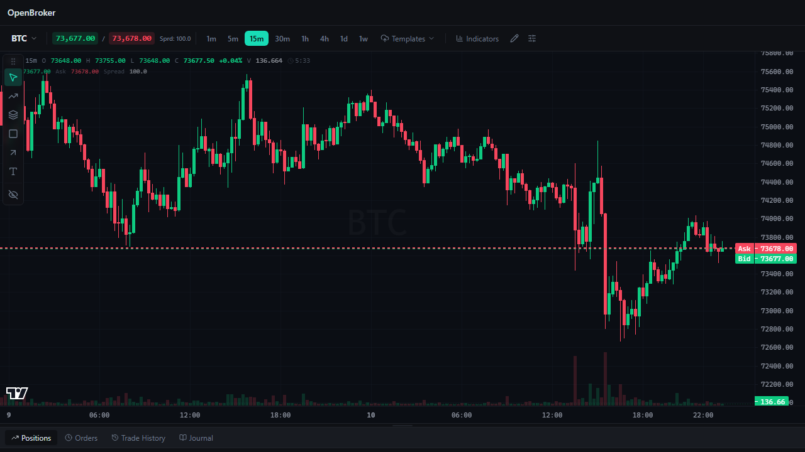

<div align="center">

# OpenBroker

### The decentralized brokerage: forex, stocks, commodities, crypto and indices in one non-custodial trading terminal

**Trade 300+ perpetual markets from your own wallet. No account, no custody, pro-grade charting. Built on [Hyperliquid](https://hyperliquid.xyz).**

[](https://github.com/dylanpersonguy/OpenBroker/actions/workflows/ci.yml)
[](LICENSE)
[](https://hyperliquid.xyz)
[](#non-custodial-by-design)
[](#tech-stack)



</div>

---

## What is OpenBroker?

**OpenBroker is an open-source decentralized brokerage platform.** It puts every major asset class behind a
single, professional trading terminal: **forex, stocks, commodities (gold, silver, oil), stock indices and
crypto**. Everything settles on-chain on Hyperliquid, so your funds stay in your own wallet at all times.

Traditional brokers make you open an account per asset class, hand over custody of your money and wait for
markets to open. OpenBroker replaces that with one terminal and one wallet: connect, pick any market, trade.

- **One platform, every market.** EUR/USD, gold, crude oil, Nvidia, Tesla, the Nikkei, Bitcoin and hundreds more, in a single watchlist.
- **Non-custodial.** OpenBroker never holds your funds and cannot withdraw them. You sign with your own wallet.
- **Trade-grade charting.** A full drawing-tool suite, indicators, multiple timeframes and a live order book.
- **Open source.** MIT licensed. Audit it, fork it, self-host it.

## Features

### Every asset class in one place

| Asset class | Examples | Instrument type |
| --- | --- | --- |
| **Crypto** | BTC, ETH, SOL, HYPE and 180+ more | Perpetual futures |
| **Forex** | EUR/USD, USD/JPY, GBP/USD | Perpetual futures |
| **Stocks** | Tesla, Nvidia, Apple, Microsoft and 100+ more | Equity perpetuals |
| **Commodities** | Gold, Silver, Crude Oil, Brent, Copper, Platinum | Commodity perpetuals |
| **Indices** | S&P 500, Nikkei 225, KOSPI 200 | Index perpetuals |

Markets are discovered live from Hyperliquid, including markets deployed through its HIP-3 builder-deployed
perpetuals, so new listings show up in OpenBroker automatically. Instruments are grouped and labelled
(for example "EUR/USD" or "Gold") and searchable in the symbol picker.

### Professional trading terminal

- **Advanced candlestick charts** from 1 minute to 1 week, with live streaming prices.
- **Full drawing-tool suite**: trend lines, channels, Fibonacci, shapes, text and more.
- **Technical indicators** including moving averages, RSI, MACD, Bollinger Bands and volume.
- **Depth of market** ladder with live bid/ask and spread.
- **Watchlist** with categories, favourites and live prices.
- **Order ticket** with market, limit and stop orders, take-profit and stop-loss, reduce-only and one-click trading.
- **Leverage and margin controls**: cross and isolated margin, with each market's maximum leverage shown up front.
- **Positions, orders, trade history and journal** panels.
- **Responsive**: works on desktop and mobile.

### Non-custodial by design

- **Your keys, your funds.** Connect any EIP-1193 browser wallet (MetaMask, Rabby, Coinbase Wallet and others).
- **Limited trading key.** Orders are signed by an approved *agent key* held only in your browser. It can place and cancel orders. It **cannot withdraw**. Revoke it any time.
- **Deposit and withdraw in the app** with your own wallet signature.
- **No sign-up, no email, no password.** Your wallet is your account.
- **Private by default.** No analytics or third-party scripts in the trading build, and a strict Content Security Policy in production.

### Built for developers

- **Adapter architecture.** The terminal talks to three small interfaces (`MarketDataSource`, `TradingGateway`, `StorageDriver`), so any venue can be plugged in.
- **Embeddable.** Use the whole terminal or mount individual panels (chart, order ticket, watchlist) in your own React app.
- **Typed end to end** with TypeScript, 745 unit tests and a Playwright end-to-end suite that runs against a simulated exchange.

## Quick start

```bash
git clone https://github.com/dylanpersonguy/OpenBroker.git
cd OpenBroker
npm install
cp .env.example .env.local
npm run dev
```

Open `http://localhost:5173`. Browsing markets and charts needs no wallet.

To run against the Hyperliquid **testnet** (recommended for your first trades), set these in `.env.local`:

```bash
VITE_ADAPTER=hyperliquid
VITE_HL_NETWORK=testnet
```

Connect a wallet, choose **Enable trading**, fund the account from the Hyperliquid testnet faucet and place a
small order.

> **Real money warning.** On mainnet, OpenBroker places real orders with real funds. Leveraged derivatives
> are risky and you can lose more than you expect. Test on testnet first. Nothing here is financial advice.

### Production build

```bash
npm run build
npm run check:size
```

The output in `dist/` is a static site you can host anywhere (Vercel, Cloudflare Pages, Netlify, GitHub Pages,
S3). There is no backend to run.

## How it works

```
┌──────────────────────────┐        ┌─────────────────────────────────────┐
│  OpenBroker terminal     │        │  Hyperliquid                        │
│  charts · order ticket   │        │  order book · matching · settlement │
│  watchlist · positions   │◄──────►│  crypto · forex · stocks ·          │
│                          │  REST  │  commodities · indices              │
│  Adapter layer           │  + WS  │                                     │
│  market data · trading   │        └─────────────────────────────────────┘
│  storage                 │
└────────────┬─────────────┘
             │ signs with
             ▼
   Your wallet (funds stay here)  +  limited agent key in your browser
```

1. **Connect** your wallet. OpenBroker reads your balances and positions directly from Hyperliquid.
2. **Enable trading** once. You approve a limited agent key that can trade but never withdraw.
3. **Trade** any market from one terminal. Orders go straight to Hyperliquid's on-chain order book.
4. **Withdraw** whenever you like, straight back to your wallet.

See [docs/ARCHITECTURE.md](docs/ARCHITECTURE.md) for the module map and [docs/SECURITY_MODEL.md](docs/SECURITY_MODEL.md)
for the security model.

## Frequently asked questions

### What is a decentralized brokerage?
A decentralized brokerage lets you trade financial markets without handing custody of your money to a company.
Orders are matched and settled on a blockchain and your funds stay in a wallet you control. OpenBroker is the
front end that makes this feel like a traditional broker terminal.

### Can I really trade forex, stocks and commodities on-chain?
Yes. Hyperliquid supports builder-deployed perpetual markets (HIP-3) that track stocks, currencies,
commodities and indices, alongside its crypto perpetuals. OpenBroker lists them all together. Which non-crypto
markets exist, and their leverage limits, are set by Hyperliquid and the market deployers, and some markets
only allow isolated margin.

### Does OpenBroker hold my funds?
No. OpenBroker is non-custodial. Your funds are held in your own Hyperliquid account under your wallet, and
the trading key OpenBroker uses cannot withdraw.

### Do I need to create an account or pass KYC?
There is no account to create: your wallet is your identity. Using the service may still be restricted in some
jurisdictions, and a terms-and-eligibility screen is shown before trading.

### Which wallets work?
Any browser wallet that supports EIP-1193 and EIP-6963, including MetaMask, Rabby and Coinbase Wallet.

### Does it support spot trading?
Today OpenBroker trades perpetual futures. Spot market support is on the roadmap.

### Is OpenBroker open source?
Yes, under the MIT license.

## Tech stack

React, TypeScript, Vite, Tailwind CSS, zustand, TanStack Query, [Lightweight Charts](https://github.com/tradingview/lightweight-charts),
viem and the [`@nktkas/hyperliquid`](https://github.com/nktkas/hyperliquid) SDK. Tested with Vitest and Playwright.

## Project structure

```
src/hyperliquid/      Hyperliquid adapter: market data, trading, wallet, onboarding, UI, compliance
src/terminal/         Embeddable terminal panels
src/adapter/          Adapter contracts and provider
src/pages/trading/    Chart, order panel, watchlist and bottom panels
e2e/                  Playwright end-to-end tests with a simulated exchange
docs/                 Architecture, security model, deployment and test checklists
```

The terminal's own documentation (adapter contract, drawing tools, indicators, embedding) lives in
[docs/TERMINAL.md](docs/TERMINAL.md).

## Roadmap

- Spot market support
- More forex pairs as they are listed on Hyperliquid
- Portfolio analytics and PnL history
- Mobile-first layout refinements
- Price alerts

## Contributing

Contributions are welcome. Read [CONTRIBUTING.md](CONTRIBUTING.md), run `npm test` and `npm run typecheck`
before you open a pull request, and see [SECURITY.md](SECURITY.md) to report a vulnerability privately.

## Acknowledgements

OpenBroker is built on the open-source OpenCharts trading terminal, TradingView's
[Lightweight Charts](https://github.com/tradingview/lightweight-charts) and [Hyperliquid](https://hyperliquid.xyz).
See [NOTICE](NOTICE) for third-party attributions.

## License

[MIT](LICENSE)

---

<sub>**Keywords:** decentralized brokerage, DeFi broker, non-custodial trading platform, on-chain forex trading,
trade stocks on-chain, commodities perpetuals, gold and oil perps, Hyperliquid trading terminal, HIP-3 markets,
crypto perpetuals, open-source trading terminal, self-custody trading, Web3 brokerage.</sub>
